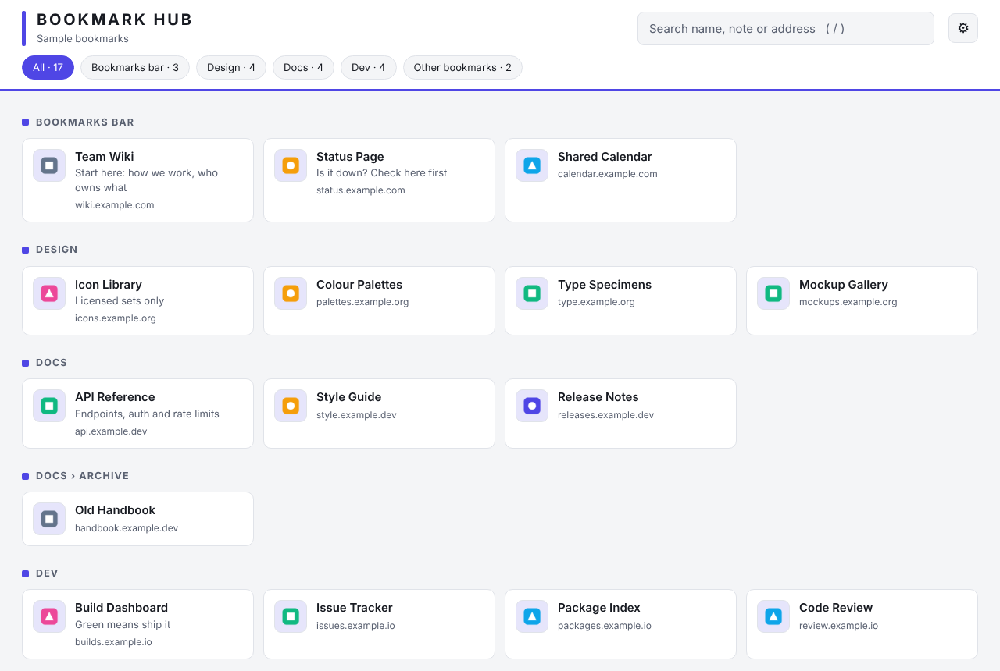
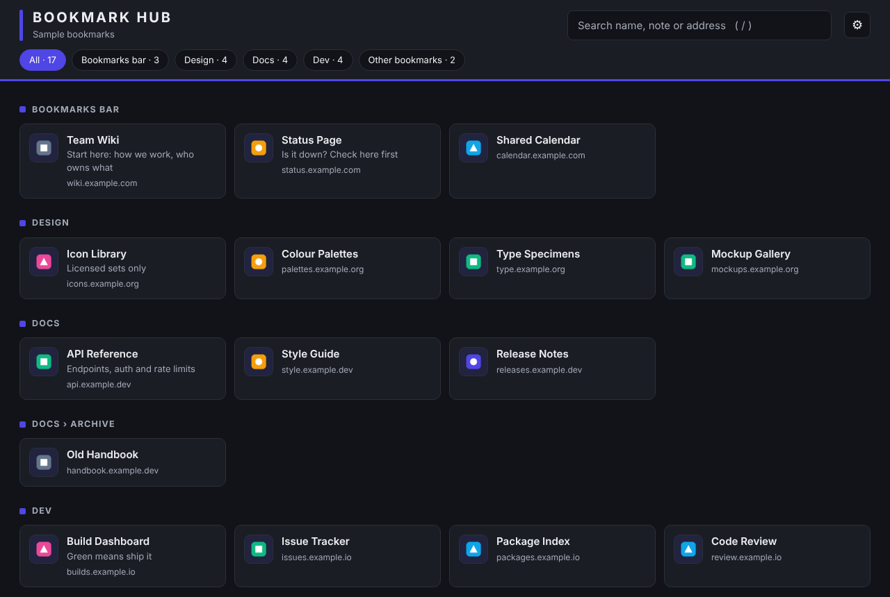

# Bookmark Hub

**Turn your browser bookmarks into a searchable start page, with site icons and notes of your own.**



<details>
<summary>Dark theme</summary>


</details>

*Screenshots use invented sample bookmarks.*

## The idea

Bookmark menus are fine for ten bookmarks and hopeless for three hundred. You end up with a long list of names, no icons, and no memory of what each one was for.

Bookmark Hub turns the bookmarks you already have into one page:

- laid out by your own folders, so nothing needs reorganising
- with each site's icon, so you can spot things at a glance
- with a short **note** you write under any bookmark ("staging login", "billing portal, ask finance for access"), which the search also looks through
- **live**: add a bookmark in the browser and it is on the page a moment later, with no export, sync step or refresh

It needs no account and no server, and it never changes your bookmarks.

## Features

- Reads your bookmarks directly, grouped by folder, with filter buttons for the top-level folders
- Instant search across name, note and address (press `/` to jump to it)
- Site icons from the browser
- Editable notes (hover a card and click the pencil, or tab to it)
- Optional **new tab page**: the hub opens whenever you open a new tab
- Your own title, subtitle and accent colour; light, dark or match-system
- Backup and restore of your notes and settings as a small JSON file
- Keyboard friendly and screen-reader friendly, and respects reduced-motion settings
- Private by design (see [PRIVACY.md](PRIVACY.md)): no network requests, no tracking, no host permissions

## Install

Store listings are not published yet, so for now install it from this repository (about a minute):

1. Download this repository (green **Code** button, then **Download ZIP**) and unzip it. Or run `python scripts/package.py` and use one of the zips in `dist/`.
2. Open `chrome://extensions` (Chrome) or `edge://extensions` (Edge).
3. Turn on **Developer mode**.
4. Click **Load unpacked** and choose the `extension` folder.

Install it in the browser **profile** you want. Extensions belong to a profile, so each profile gets its own hub, its own bookmarks and its own notes.

**Don't want to replace your new tab page?** Use the toolbar-only build. Run `python scripts/package.py`, unzip `dist/bookmark-hub-toolbar.zip` to a folder, and load that folder instead. The hub then opens only when you click the toolbar button. (Or delete the `chrome_url_overrides` block from `extension/manifest.json` before loading.)

## Using it

- **Search:** type in the box, or press `/`. `Esc` clears it.
- **Folders:** the buttons under the title filter by top-level folder.
- **Notes:** hover a bookmark and click the pencil. `Enter` saves, `Shift+Enter` adds a new line.
- **Settings:** the gear button. Title, subtitle, accent colour, appearance, open in a new tab, and backup.

## Good to know

- Only `http` and `https` bookmarks are shown. Bookmarklets (`javascript:`) and browser pages (`chrome://`, `edge://`) are skipped.
- Notes are stored in the browser profile and are **not** synced between computers. Use Export and Import to move them.
- Icons come from the browser. For a site the browser has no icon for yet (for example a bookmark you have never visited), you will see the browser's default icon.
- **Edge may say it "turned off" the extension** because it changes your new tab page. That is Edge being careful with extensions loaded from a folder. Click **Turn on** to keep the new tab page, or use the toolbar-only build, which never asks. Store-installed copies do not show this prompt.
- Built for Chromium-based browsers (Manifest V3). It is tested in Chromium; Chrome and Edge should work the same way, and reports from other Chromium browsers are welcome. Firefox and Safari are not supported.

## Development

There is no build step and no dependencies. The extension is plain JavaScript, HTML and CSS in [`extension/`](extension).

```
extension/      the extension itself (load this folder unpacked)
scripts/        packaging script
tests/smoke.py  end-to-end test in a real Chromium
docs/           screenshots
```

Run the test (it loads the unpacked extension in headless Chromium, creates sample bookmarks and checks the page):

```
pip install playwright
python -m playwright install chromium
python tests/smoke.py
```

Add `--screenshots docs` to regenerate the screenshots with the sample data.

## Contributing

Issues and pull requests are welcome. Please keep the extension free of network requests, remote code and extra permissions unless there is a strong reason, and say why in the pull request.

## Author

Made by David Nino. [LinkedIn](https://www.linkedin.com/in/david-nino-profile/) · [Report a problem](https://github.com/daoud80/bookmark-hub/issues)

## Licence

[MIT](LICENSE)
